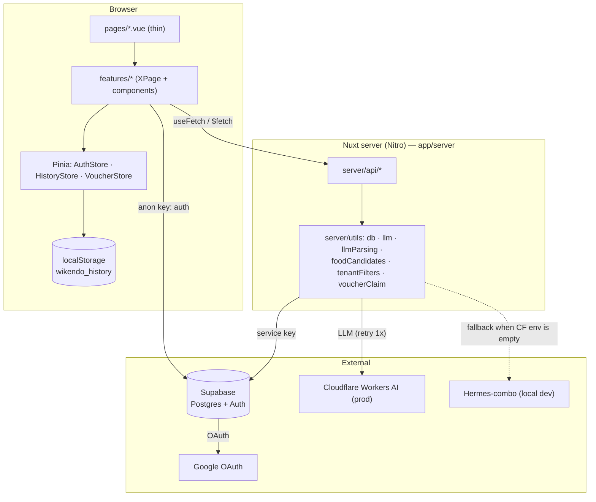
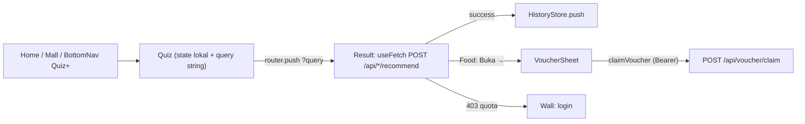

# Wikendo — Architecture

> Conventions: [CONVENTIONS.md](./CONVENTIONS.md) · Terms: [GLOSSARY.md](./GLOSSARY.md) · AI rules: [../../AGENTS.md](../../AGENTS.md)

**Stack:** Nuxt 4 (SSR) · Vue 3 Composition API · TypeScript strict · Pinia (setup stores) · Tailwind · Supabase · Vitest · ESLint 10 + Prettier
**Purpose:** 30-second quiz → 5 weekend place recommendations in Jabodetabek; 20-second quiz → 5 mall tenants + voucher. The Tempat (Place) and Makan (Food) modes are **never mixed**.

Code lives in `app/`. The repo root also contains `docs/`, `design/`, `data/`, `supabase/` (not Nuxt code).

---

## System Overview



Solid arrows = synchronous HTTP. Dashed = provider choice based on env.

---

## Layers

| Layer         | Folder          | Responsibility                                          | Hard constraint                              |
| ------------- | --------------- | ------------------------------------------------------- | -------------------------------------------- |
| Pages         | `app/pages/`    | Nuxt route (file-based) — renders 1 `XPage.vue`        | No business logic                            |
| Feature slice | `app/features/` | Vertical slice per domain                             | Must not import other slices (ESLint error)  |
| Common        | `app/common/`   | Components, composables, store, utils, constants, types | Must not import `features/`                  |
| Utils         | `app/utils/`    | Pure app-wide functions (error, pagination, url, boolean) | No side effects, no store                    |
| Server        | `app/server/`   | API + DB/LLM access                                     | Secrets live only here; client must not import |
| Plugins       | `app/plugins/`  | Boot wiring (`v-dompurify-html`)                        | No component state                           |

## Folder Structure

```text
app/
├── pages/                 # thin routes → features/<f>/<X>Page.vue
├── features/
│   ├── home/  place/  food/  mall/  auth/  account/  history/
│   │   └── <X>Page.vue · components/ · utils/ · constants/ · @types/ · store/ · __tests__/
├── common/
│   ├── components/  composables/  store/  utils/  constants/  types/
├── utils/                 # pure app-wide (+ __tests__)
├── server/
│   ├── api/               # quota, place/recommend, food/recommend, malls, voucher/claim
│   └── utils/             # db, llm, llmParsing, foodCandidates, tenantFilters, voucherClaim
├── plugins/  test/  app.vue  nuxt.config.ts  eslint.config.mjs
```

Tests are co-located in `__tests__/*.spec.ts` (sibling of the source).

---

## Feature Lifecycle: Quiz → Result → History/Voucher



The quiz does not fetch; answers are passed via the query string. Result reads `route.query` and then POSTs to the API. Details: [quiz-place](./flows/quiz-place/README.md), [quiz-food](./flows/quiz-food/README.md).

---

## Topic Index

| Topic                                                                | Scope                                                        |
| -------------------------------------------------------------------- | ------------------------------------------------------------ |
| [home](./flows/home/README.md)                                       | Landing + quota wallet + mall entrypoint                    |
| [quiz-place](./flows/quiz-place/README.md)                         | 5-question quiz + place result (LLM)                       |
| [quiz-food](./flows/quiz-food/README.md)                           | 4-question quiz + tenant result + gift voucher                 |
| [mall-directory](./flows/mall-directory/README.md)                   | `/mall`, `/mall/:slug`, infinity scroll, filter, promo strip |
| [auth](./flows/auth/README.md)                                       | Login, register, check-email, Google, AuthStore, Account   |
| [quota](./flows/quota/README.md)                                     | Anon quota (cookie), `GET /api/quota`, wall                 |
| [voucher-claim](./flows/voucher-claim/README.md)                     | Voucher claim: VoucherStore + `POST /api/voucher/claim`    |
| [history](./flows/history/README.md)                                 | localStorage history                                        |
| [layout-navigation](./flows/layout-navigation/README.md)             | `app.vue`, TopNav, BottomNav, QuizPlusSheet               |
| [llm](./flows/llm/README.md)                                         | CF vs Hermes provider, retry, validation, fallback         |
| [state-management](./flows/cross-cutting/state-management/README.md) | When to use Pinia vs composable vs `useFetch`              |
| [security](./flows/cross-cutting/security/README.md)                 | Secrets, XSS, auth, rate-limit, scan                         |
| [testing-ci](./flows/cross-cutting/testing-ci/README.md)             | Test strategy, Husky, CI                                   |
| [shared-ui](./flows/cross-cutting/shared-ui/README.md)               | Components & composables in `common/`                      |

## Explicit Exclusions

| Item                              | Reason                                                                      |
| --------------------------------- | --------------------------------------------------------------------------- |
| `supabase/` (migrations, seed, tests) | DB schema is documented in `docs/04-Database-Schema.md`; not Nuxt code.     |
| `design/`, `data/`                | Design boards & seed CSV — not code.                                       |
| `docs/01…24` (PRD, ADR, addendum) | Historical product docs; code architecture lives in this folder.          |

## Not Covered (future work)

- Wishlist & Save (no backend yet; UI wall only).
- Quota for logged-in users (the server always takes the anon path today — see [quota](./flows/quota/README.md)).
- Detailed DB schema (see `docs/04-Database-Schema.md`).
