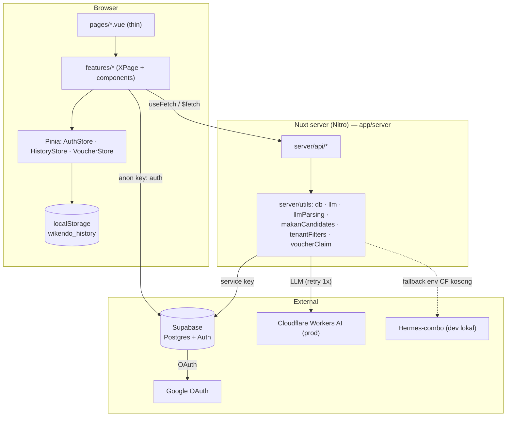
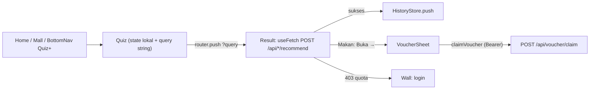

# Wikendo — Architecture

> Conventions: [CONVENTIONS.md](./CONVENTIONS.md) · Terms: [GLOSSARY.md](./GLOSSARY.md) · AI rules: [../../AGENTS.md](../../AGENTS.md)

**Stack:** Nuxt 4 (SSR) · Vue 3 Composition API · TypeScript strict · Pinia (setup stores) · Tailwind · Supabase · Vitest · ESLint 10 + Prettier
**Purpose:** Quiz 30 detik → 5 rekomendasi tempat weekend Jabodetabek; quiz 20 detik → 5 tenant mall + voucher. Mode Tempat dan Makan **tidak pernah dicampur**.

Kode ada di `app/`. Root repo juga berisi `docs/`, `design/`, `data/`, `supabase/` (bukan kode Nuxt).

---

## System Overview



Solid arrows = synchronous HTTP. Dashed = pilihan provider berdasarkan env.

---

## Layers

| Layer          | Folder           | Responsibility                                          | Hard constraint                                      |
| -------------- | ---------------- | ------------------------------------------------------- | ---------------------------------------------------- |
| Pages          | `app/pages/`     | Route Nuxt (file-based) — render 1 `XPage.vue`          | Tanpa business logic                                 |
| Feature slice  | `app/features/`  | Vertical slice per domain                               | Tidak boleh import slice lain (ESLint error)         |
| Common         | `app/common/`    | Components, composables, store, utils, constants, types | Tidak boleh import `features/`                       |
| Utils          | `app/utils/`     | Fungsi pure app-wide (error, pagination, url, boolean)  | Tanpa side effect, tanpa store                       |
| Server         | `app/server/`    | API + akses DB/LLM                                      | Secret hanya di sini; client dilarang import         |
| Plugins        | `app/plugins/`   | Wiring boot (`v-dompurify-html`)                        | Tanpa state komponen                                 |

## Folder Structure

```text
app/
├── pages/                 # routes tipis → features/<f>/<X>Page.vue
├── features/
│   ├── home/  tempat/  makan/  mall/  auth/  account/  history/
│   │   └── <X>Page.vue · components/ · utils/ · constants/ · @types/ · store/ · __tests__/
├── common/
│   ├── components/  composables/  store/  utils/  constants/  types/
├── utils/                 # pure app-wide (+ __tests__)
├── server/
│   ├── api/               # quota, tempat/recommend, makan/recommend, malls, voucher/claim
│   └── utils/             # db, llm, llmParsing, makanCandidates, tenantFilters, voucherClaim
├── plugins/  test/  app.vue  nuxt.config.ts  eslint.config.mjs
```

Tes ditaruh co-located di `__tests__/*.spec.ts` (sibling dengan source).

---

## Feature Lifecycle: Quiz → Result → Riwayat/Voucher



Quiz tidak fetch; jawaban dikirim lewat query string. Result membaca `route.query` lalu POST ke API. Detail: [quiz-tempat](./flows/quiz-tempat/README.md), [quiz-makan](./flows/quiz-makan/README.md).

---

## Topic Index

| Topic                                                              | Cakupan                                                          |
| ------------------------------------------------------------------ | ---------------------------------------------------------------- |
| [home](./flows/home/README.md)                                     | Landing + wallet quota + entrypoint mall                         |
| [quiz-tempat](./flows/quiz-tempat/README.md)                       | Quiz 5 tanya + result tempat (LLM)                               |
| [quiz-makan](./flows/quiz-makan/README.md)                         | Quiz 4 tanya + result tenant + voucher gift                      |
| [mall-directory](./flows/mall-directory/README.md)                 | `/mall`, `/mall/:slug`, infinity scroll, filter, promo strip     |
| [auth](./flows/auth/README.md)                                     | Login, register, check-email, Google, AuthStore, Akun            |
| [quota](./flows/quota/README.md)                                   | Quota anon (cookie), `GET /api/quota`, wall                      |
| [voucher-claim](./flows/voucher-claim/README.md)                   | Klaim voucher: VoucherStore + `POST /api/voucher/claim`          |
| [history](./flows/history/README.md)                               | Riwayat localStorage                                             |
| [layout-navigation](./flows/layout-navigation/README.md)           | `app.vue`, AppHeader, BottomNav, QuizPlusSheet                   |
| [llm](./flows/llm/README.md)                                       | Provider CF vs hermes, retry, validasi, fallback                 |
| [state-management](./flows/cross-cutting/state-management/README.md) | Kapan Pinia vs composable vs `useFetch`                       |
| [security](./flows/cross-cutting/security/README.md)               | Secrets, XSS, auth, rate-limit, scan                             |
| [testing-ci](./flows/cross-cutting/testing-ci/README.md)           | Strategi test, Husky, CI                                         |
| [shared-ui](./flows/cross-cutting/shared-ui/README.md)             | Komponen & composable di `common/`                               |

## Explicit Exclusions

| Item                              | Alasan                                                                          |
| --------------------------------- | ------------------------------------------------------------------------------- |
| `supabase/` (migrasi, seed, test) | Skema DB didokumentasikan di `docs/04-Database-Schema.md`; bukan kode Nuxt.     |
| `design/`, `data/`                | Board desain & CSV seed — bukan kode.                                           |
| `docs/01…24` (PRD, ADR, addendum) | Dokumen produk historis; arsitektur kode ada di folder ini.                     |

## Not Covered (future work)

- Wishlist & Simpan (belum ada backend; hanya wall UI).
- Quota untuk user login (server selalu jalur anon saat ini — lihat [quota](./flows/quota/README.md)).
- Skema DB rinci (lihat `docs/04-Database-Schema.md`).
