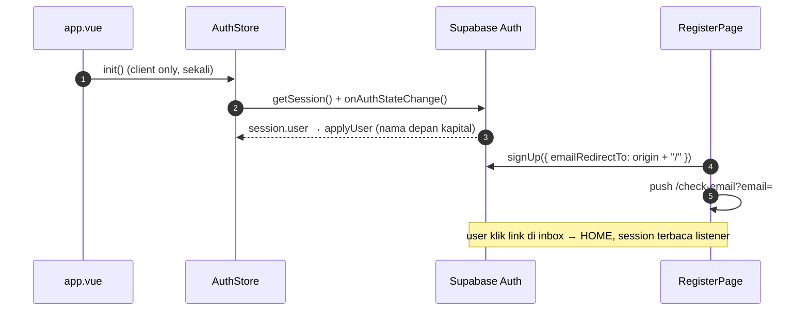

# Auth

## TL;DR

Auth sepenuhnya Supabase dari browser (anon key). `AuthStore` (Pinia) memegang session (isLoggedIn/email/displayName/initial) dan di-`init()` sekali di `app.vue`. Login: email+password atau Google OAuth satu pintu; register memakai magic-link (`/check-email`). Akun & header 2-state membaca store yang sama.

## Entry Points

- `app/features/auth/LoginPage.vue`, `RegisterPage.vue`, `CheckEmailPage.vue` (route `/login`, `/register`, `/check-email`).
- `app/features/account/AccountPage.vue` — hub Akun (`/account`).
- `app/app.vue` — `onMounted(() => auth.init())`.

## Sequence

1. `buildDisplayName`: `full_name` > `name` > prefix email > "Teman".
2. Login/Register menghormati `?redirect=` lewat `getRedirectQuery`; `buildOriginUrl` membuat URL absolut di browser.
3. Google: `useGoogleSignIn(redirect)` (label & redirect sama untuk login + register; register mewajibkan centang Syarat dulu).
4. `signOut()` selalu mereset state walau Supabase error.

## Key Components

| Component          | File                                              | Role                                          |
| ------------------ | ------------------------------------------------- | --------------------------------------------- |
| `AuthStore`        | `app/common/store/AuthStore.ts`                   | Session sumber kebenaran (Pinia setup store)  |
| `useSupabaseBrowser`| `app/common/composables/useSupabaseBrowser.ts`   | Singleton client browser (anon key)           |
| `useGoogleSignIn`  | `app/features/auth/composables/useGoogleSignIn.ts`| OAuth 1-klik + state loading                  |
| `PasswordField`, `GoogleButton`, `AuthBanner` | `app/features/auth/components/` | UI bersama login/register         |

## Failure & State

- Offline / SSR tanpa session → tetap anon (`refresh()` menelan error).
- `init()` idempotent: listener tidak dipasang ganda.
- Tombol auth disabled + spinner saat request (anti double-submit).

## See Also

[quota](../quota/README.md) · [state-management](../cross-cutting/state-management/README.md) · [security](../cross-cutting/security/README.md)
