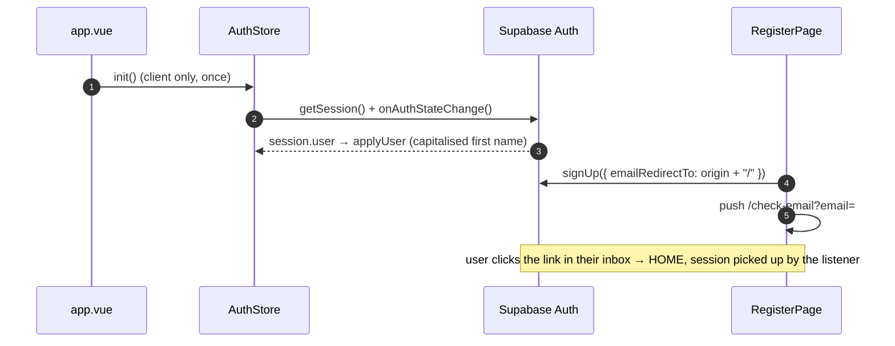

# Auth

## TL;DR

Auth is entirely Supabase from the browser (anon key). `AuthStore` (Pinia) holds the session (isLoggedIn/email/displayName/initial) and is `init()`-ed once in `app.vue`. Login: email+password or a single-entry Google OAuth; register uses a magic link (`/check-email`). The Account hub and the 2-state header read the same store.

## Entry Points

- `app/features/auth/LoginPage.vue`, `RegisterPage.vue`, `CheckEmailPage.vue` (route `/login`, `/register`, `/check-email`).
- `app/features/account/AccountPage.vue` — Account hub (`/account`).
- `app/app.vue` — `onMounted(() => auth.init())`.

## Sequence

1. `buildDisplayName`: `full_name` > `name` > prefix email > "Teman".
2. Login/Register honour `?redirect=` via `getRedirectQuery`; `buildOriginUrl` builds an absolute URL in the browser.
3. Google: `useGoogleSignIn(redirect)` (same label & redirect for login + register; register requires ticking the Terms checkbox first).
4. `signOut()` always resets state even if Supabase errors.

## Key Components

| Component                                     | File                                               | Role                                         |
| --------------------------------------------- | -------------------------------------------------- | -------------------------------------------- |
| `AuthStore`                                   | `app/common/store/AuthStore.ts`                    | Session source of truth (Pinia setup store) |
| `useSupabaseBrowser`                          | `app/common/composables/useSupabaseBrowser.ts`     | Browser client singleton (anon key)        |
| `useGoogleSignIn`                             | `app/features/auth/composables/useGoogleSignIn.ts` | 1-click OAuth + loading state             |
| `PasswordField`, `GoogleButton`, `AuthBanner` | `app/features/auth/components/`                    | UI shared by login/register               |

## Failure & State

- Offline / SSR without a session → stays anon (`refresh()` swallows errors).
- `init()` is idempotent: the listener is not attached twice.
- Auth buttons are disabled + show a spinner during a request (anti double-submit).

## See Also

[quota](../quota/README.md) · [state-management](../cross-cutting/state-management/README.md) · [security](../cross-cutting/security/README.md)
