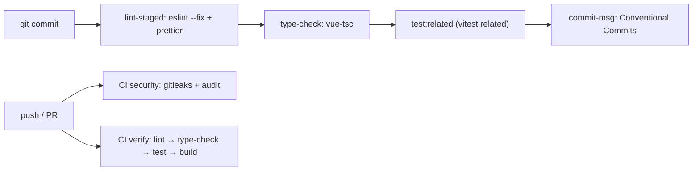

# Testing & CI

## TL;DR

Vitest + happy-dom, tests co-located in `__tests__/*.spec.ts`. There are 3 kinds: pure unit (utils), store/composable unit (mocked Supabase/`$fetch`), and file-assert (reads source as text to lock UI copy/tokens). The same gates run in Husky (commit) and GitHub Actions (CI).

## Test Types

| Type              | Location                                 | Isolation                                                                                            |
| ----------------- | ---------------------------------------- | --------------------------------------------------------------------------------------------------- |
| Unit — utility    | `*/utils/__tests__/*.spec.ts`            | No mocks                                                                                            |
| Unit — store      | `*/store/__tests__/*.spec.ts`            | `vi.hoisted` + `vi.mock` for Supabase, `vi.stubGlobal("$fetch")`                                  |
| Unit — composable | `common/composables/__tests__/*.spec.ts` | Mocked fetch                                                                                        |
| File-assert       | `*/__tests__/*Page.spec.ts` etc.         | `readSource()` from `app/test/utils.ts` (hex lowercased + whitespace collapsed to survive Prettier) |

## Gates

## Rules

- New functions/composables/stores must have `__tests__/<name>.spec.ts` (TDD: red first).
- Never use `--no-verify`; fix the root cause. CI catches it anyway.
- `pnpm lint` = ESLint (0 warning) + `prettier --check`; `pnpm type-check` = `nuxt typecheck`.

## See Also

[security](../security/README.md)
