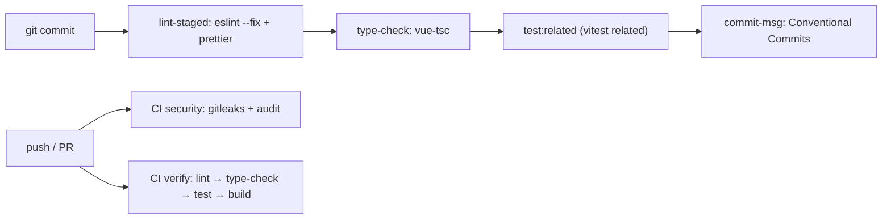

# Testing & CI

## TL;DR

Vitest + happy-dom, test co-located di `__tests__/*.spec.ts`. Ada 3 jenis: unit pure (utils), unit store/composable (mock Supabase/`$fetch`), dan file-assert (membaca source sebagai teks untuk mengunci copy/token UI). Gerbang yang sama dijalankan Husky (commit) dan GitHub Actions (CI).

## Test Types

| Jenis             | Lokasi                                   | Isolasi                                                                                             |
| ----------------- | ---------------------------------------- | --------------------------------------------------------------------------------------------------- |
| Unit — utility    | `*/utils/__tests__/*.spec.ts`            | Tanpa mock                                                                                          |
| Unit — store      | `*/store/__tests__/*.spec.ts`            | `vi.hoisted` + `vi.mock` untuk Supabase, `vi.stubGlobal("$fetch")`                                  |
| Unit — composable | `common/composables/__tests__/*.spec.ts` | Fetch mock                                                                                          |
| File-assert       | `*/__tests__/*Page.spec.ts` dll.         | `readSource()` dari `app/test/utils.ts` (hex lowercase + whitespace dipadatkan agar tahan Prettier) |

## Gates

## Rules

- Fungsi/komposable/store baru wajib punya `__tests__/<nama>.spec.ts` (TDD: merah dulu).
- Jangan `--no-verify`; perbaiki akar masalah. CI tetap menangkap.
- `pnpm lint` = ESLint (0 warning) + `prettier --check`; `pnpm type-check` = `nuxt typecheck`.

## See Also

[security](../security/README.md)
