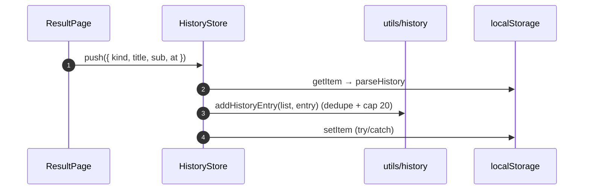

# History (Riwayat)

## TL;DR

Riwayat hasil quiz disimpan di `localStorage` key `wikendo_history` (maks 20, terbaru di depan, judul sama tidak ganda) — tanpa tabel/API, jadi anon pun punya riwayat. `HistoryStore` ditulis oleh kedua result page dan dibaca `HistoryPage`.

## Entry Points

- `HistoryStore.push(entry)` dipanggil `TempatResultPage` dan `MakanResultPage` saat data sukses.
- `HistoryPage.vue` (`/riwayat`) memanggil `history.load()` di `onMounted`.

## Sequence



## Data

```json
[{ "kind": "makan", "title": "Kopi Kekinian", "sub": "L2 · GI", "at": 1760600000000 }]
```

## Failure & State

- Storage rusak/penuh/diblok → list kosong atau tidak tersimpan; UI tidak crash (semua akses di-guard `typeof window` + try/catch).
- Tidak ada sinkronisasi antar perangkat (disengaja).

## See Also

[state-management](../cross-cutting/state-management/README.md)
