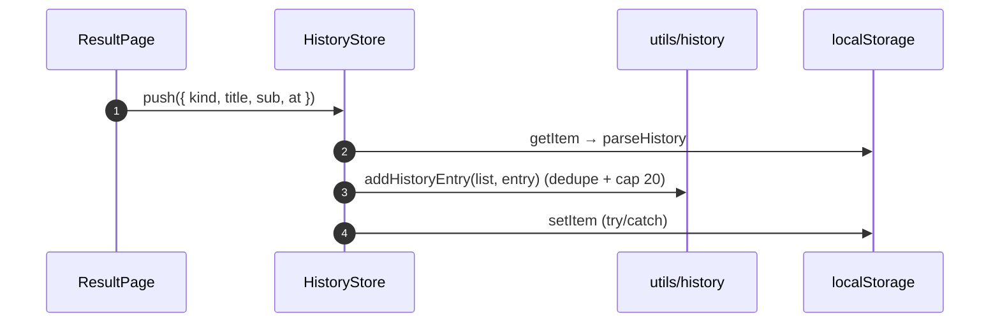

# History (Riwayat)

## TL;DR

Quiz result history is stored in `localStorage` key `wikendo_history` (max 20, newest first, no duplicate titles) — no table/API, so even anon users have history. `HistoryStore` is written by both result pages and read by `HistoryPage`.

## Entry Points

- `HistoryStore.push(entry)` is called by `PlaceResultPage` and `FoodResultPage` when data loads successfully.
- `HistoryPage.vue` (`/history`) calls `history.load()` in `onMounted`.

## Sequence



## Data

```json
[
  {
    "kind": "food",
    "title": "Kopi Kekinian",
    "sub": "L2 · GI",
    "at": 1760600000000
  }
]
```

## Failure & State

- Storage corrupt/full/blocked → empty list or not saved; the UI does not crash (every access is guarded by `typeof window` + try/catch).
- No cross-device sync (intentional).

## See Also

[state-management](../cross-cutting/state-management/README.md)
