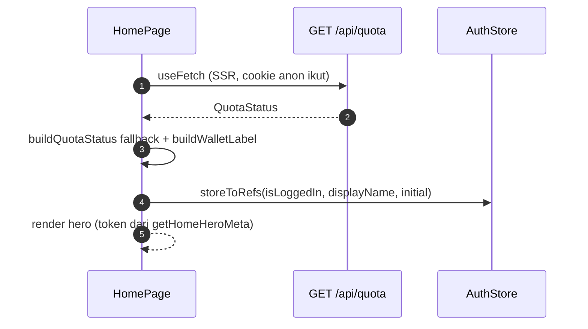

# Home

## TL;DR

Home mendorong landing → quiz. Hero "QUOTA HARI INI" menampilkan sisa quota jujur dari `GET /api/quota`, 2 CTA (Tempat/Makan), entrypoint Mall, dan sapaan 2-state (anon vs login) dari `AuthStore`.

## Entry Points

- `app/pages/index.vue` — route `/` (thin) → `HomePage.vue`.

## Sequence

1. `useFetch<QuotaStatus>("/api/quota")` dijalankan saat SSR (cookie anon diteruskan).
2. Gagal fetch → fallback `buildQuotaStatus({ used 0, anon })`, bukan angka register.
3. `buildWalletLabel` menghasilkan headline + chip; `exhausted` memunculkan CTA login.

## Key Components

| Component         | File                                     | Role                                          |
| ----------------- | ---------------------------------------- | --------------------------------------------- |
| `HomePage`        | `app/features/home/HomePage.vue`         | Hero, CTA, ikon cepat, kartu mall             |
| `getHomeHeroMeta` | `app/features/home/utils/homeHero.ts`    | Token warna hero (pure, tested)               |

## See Also

[quota](../quota/README.md) · [auth](../auth/README.md)
