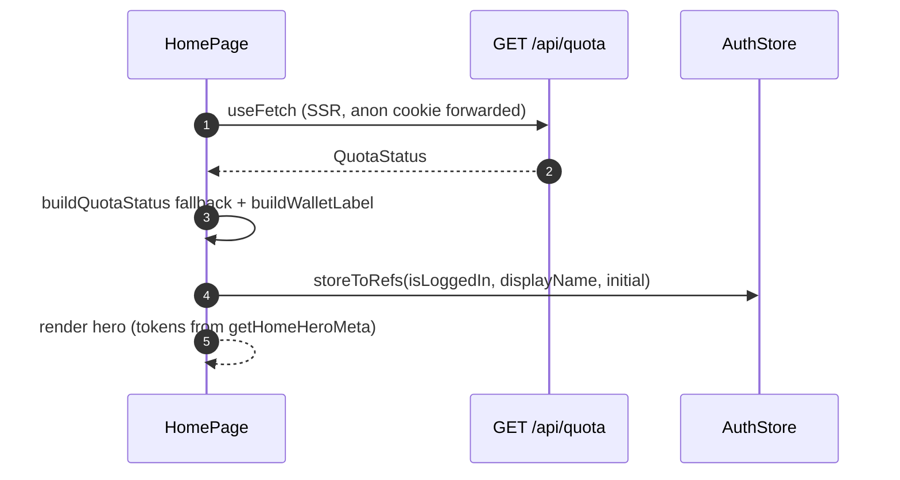

# Home

## TL;DR

Home drives landing → quiz. The "QUOTA HARI INI" hero shows the honest remaining quota from `GET /api/quota`, 2 CTAs (Tempat/Makan), the Mall entrypoint, and a 2-state greeting (anon vs logged in) from `AuthStore`.

## Entry Points

- `app/pages/index.vue` — route `/` (thin) → `HomePage.vue`.

## Sequence

1. `useFetch<QuotaStatus>("/api/quota")` runs during SSR (the anon cookie is forwarded).
2. Fetch fails → fallback `buildQuotaStatus({ used 0, anon })`, not the registered numbers.
3. `buildWalletLabel` produces the headline + chips; `exhausted` shows the login CTA.

## Key Components

| Component         | File                                  | Role                              |
| ----------------- | ------------------------------------- | --------------------------------- |
| `HomePage`        | `app/features/home/HomePage.vue`      | Hero, CTA, quick icons, mall card|
| `getHomeHeroMeta` | `app/features/home/utils/homeHero.ts` | Hero colour tokens (pure, tested)|

## See Also

[quota](../quota/README.md) · [auth](../auth/README.md)
