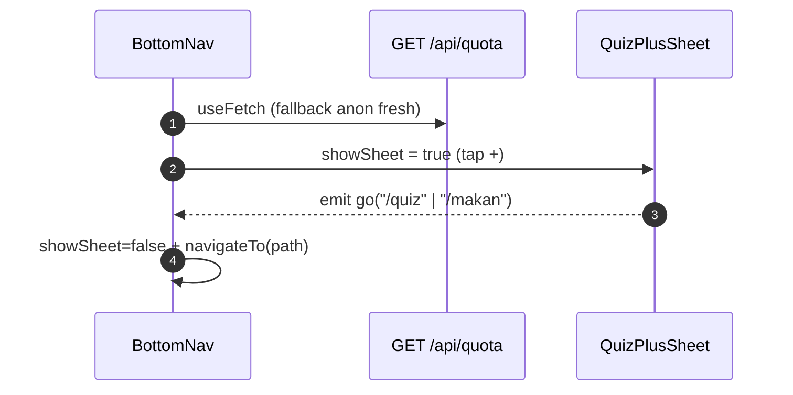

# Layout & Navigation

## TL;DR

`app.vue` adalah layout global tipis: `AppHeader` (sticky, 2-state) + `<NuxtPage />` + footer `#tentang` + `BottomNav` (5 tab fixed, thumb-zone) dengan `pb-24` supaya konten tidak tertutup. Tab tengah **Quiz+** bukan route: membuka `QuizPlusSheet` dengan 2 intent (Tempat/Makan) berikut sisa quota jujur.

## Entry Points

- `app/app.vue` — `useAuthStore().init()` di `onMounted`.
- `app/common/components/BottomNav.vue` — tab Home, Mall, Quiz+, Riwayat, Akun (`isNavActive`).

## Sequence

## Key Components

| Component       | File                                      | Role                                           |
| --------------- | ----------------------------------------- | ---------------------------------------------- |
| `AppHeader`     | `app/common/components/AppHeader.vue`     | Anon: Login/Register; login: avatar + dropdown |
| `BottomNav`     | `app/common/components/BottomNav.vue`     | 5 tab, aktif lime + dot                        |
| `QuizPlusSheet` | `app/common/components/QuizPlusSheet.vue` | 2 kartu intent; habis → "Besok lagi 00.00"     |
| `isNavActive`   | `app/common/utils/nav.ts`                 | Penentu tab aktif (pure, tested)               |

## See Also

[auth](../auth/README.md) · [quota](../quota/README.md)
