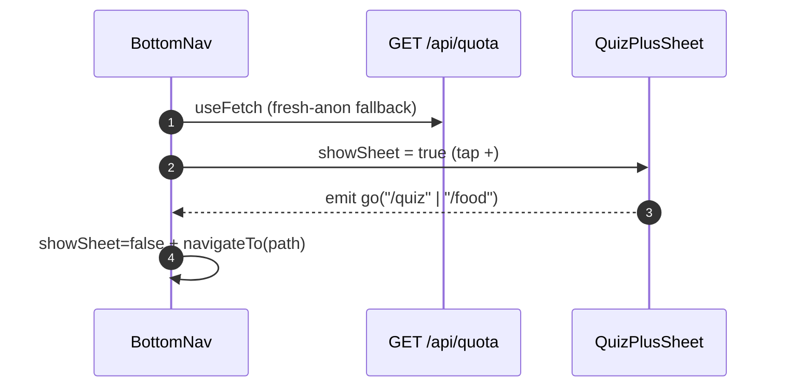

# Layout & Navigation

## TL;DR

`app.vue` is a thin global layout: `AppHeader` (sticky, 2-state) + `<NuxtPage />` + `#tentang` footer + `BottomNav` (5 fixed tabs, thumb zone) with `pb-24` so content is not covered. The centre **Quiz+** tab is not a route: it opens `QuizPlusSheet` with 2 intents (Tempat/Makan) along with the honest remaining quota.

## Entry Points

- `app/app.vue` — `useAuthStore().init()` in `onMounted`.
- `app/common/components/BottomNav.vue` — tab Home, Mall, Quiz+, Riwayat, Akun (`isNavActive`).

## Sequence

## Key Components

| Component       | File                                      | Role                                           |
| --------------- | ----------------------------------------- | ---------------------------------------------- |
| `AppHeader`     | `app/common/components/AppHeader.vue`     | Anon: Login/Register; login: avatar + dropdown |
| `BottomNav`     | `app/common/components/BottomNav.vue`     | 5 tabs, active = lime + dot                    |
| `QuizPlusSheet` | `app/common/components/QuizPlusSheet.vue` | 2 kartu intent; habis → "Besok lagi 00.00"     |
| `isNavActive`   | `app/common/utils/nav.ts`                 | Active-tab resolver (pure, tested)            |

## See Also

[auth](../auth/README.md) · [quota](../quota/README.md)
