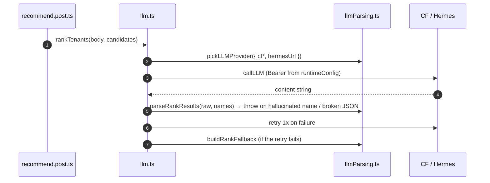

# LLM

## TL;DR

The LLM is used sparingly: Food filters candidates from the DB first (free) and the LLM only ranks the Top 5 + a 1-sentence reason; Place asks for 5 recommendations. The provider is chosen from env: Cloudflare Workers AI (prod) when `cfAccountId` + `cfApiToken` are both set, otherwise local Hermes-combo. Every response is validated; a failure triggers 1 retry, and Food has a deterministic fallback.

## Entry Points

- `callLLM(system, user)` — POST `/v1/chat/completions` (OpenAI-compatible), timeout 15 s, `max_tokens` 2000.
- `generatePlace(input)`, `rankTenants(input, candidates)` — called by the recommend routes.

## Sequence

1. `cleanJSON` strips markdown fences + any text before/after the JSON.
2. `parseRankResults` rejects names outside the candidates (anti-hallucination); `parsePlaceResults` rejects a wrong shape.
3. Secrets (`cfApiToken`, `hermesApiKey`) are read only on the server via `useRuntimeConfig()`.

## Failure & State

- Food: LLM fails 2x → `buildRankFallback` (first 5 candidates + generic reason) → never 500 because of the LLM.
- Place: LLM fails 2x → error is thrown to the route (500).
- Production cannot reach `localhost:20128` → the Cloudflare env is required on Vercel.

## See Also

[quiz-place](../quiz-place/README.md) · [quiz-food](../quiz-food/README.md)
