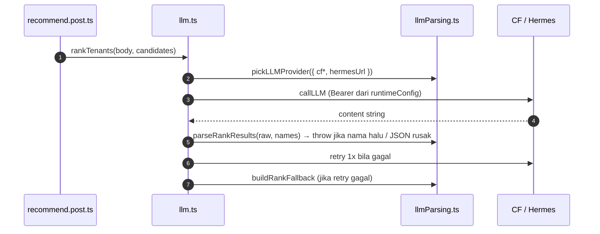

# LLM

## TL;DR

LLM dipakai hemat: Makan memfilter kandidat dari DB dulu (gratis) dan LLM hanya me-ranking Top 5 + 1 kalimat alasan; Tempat meminta 5 rekomendasi. Provider dipilih dari env: Cloudflare Workers AI (prod) bila `cfAccountId` + `cfApiToken` lengkap, selain itu Hermes-combo lokal. Semua respons divalidasi; kegagalan memicu retry 1x, dan Makan punya fallback deterministik.

## Entry Points

- `callLLM(system, user)` — POST `/v1/chat/completions` (OpenAI-compatible), timeout 15 dtk, `max_tokens` 2000.
- `generateTempat(input)`, `rankTenants(input, candidates)` — dipanggil route recommend.

## Sequence

1. `cleanJSON` membuang fence markdown + teks sebelum/sesudah JSON.
2. `parseRankResults` menolak nama di luar kandidat (anti-halusinasi); `parseTempatResults` menolak shape salah.
3. Secret (`cfApiToken`, `hermesApiKey`) hanya dibaca server via `useRuntimeConfig()`.

## Failure & State

- Makan: LLM gagal 2x → `buildRankFallback` (5 kandidat pertama + alasan generik) → tidak pernah 500 karena LLM.
- Tempat: LLM gagal 2x → error dilempar ke route (500).
- Produksi tidak bisa mencapai `localhost:20128` → wajib env Cloudflare di Vercel.

## See Also

[quiz-tempat](../quiz-tempat/README.md) · [quiz-makan](../quiz-makan/README.md)
