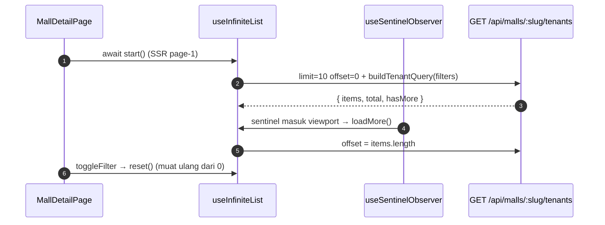

# Mall Directory

## TL;DR

`/mall` (hub 5 mall) dan `/mall/:slug` (tenant) adalah direktori SEO tanpa login/quota/LLM. Infinity scroll 10/page (SSR page-1, lanjut di client), filter chip server-side (reset page), search keyword client-side, strip promo di atas list, dan CTA ke `/makan?mall=slug`.

## Entry Points

- `app/features/mall/MallListPage.vue` — `GET /api/malls?limit&offset`.
- `app/features/mall/MallDetailPage.vue` — `GET /api/malls/:slug/tenants?limit&offset&halal&budget&mission`.

## Sequence



1. Tanpa `?limit` API mengembalikan array legacy (40 tenant); `applyInfinitePage` membungkusnya (`hasMore` false).
2. Filter kolom di SQL; `mission` (array) disaring di memori; paging di-slice setelah semua filter.
3. `getTenantPromo` menurunkan badge promo dari `promo` atau `hype_tiktok` — bukan data bohong.

## Key Components

| Component             | File                                            | Role                             |
| --------------------- | ----------------------------------------------- | -------------------------------- |
| `useInfiniteList`     | `app/common/composables/useInfiniteList.ts`     | start / loadMore / reset + state |
| `useSentinelObserver` | `app/common/composables/useSentinelObserver.ts` | IntersectionObserver sentinel    |
| `applyInfinitePage`   | `app/utils/pagination.ts`                       | Gabung page + dedupe (pure)      |
| `TenantCard`          | `app/features/mall/components/TenantCard.vue`   | Kartu tenant S2c                 |
| `PromoStrip`          | `app/features/mall/components/PromoStrip.vue`   | Strip promo V13C (maks 3)        |

## Data

```json
{
  "items": [
    {
      "name": "Kopi Kekinian",
      "category": "kopi",
      "lantai": "2",
      "halal": true
    }
  ],
  "total": 40,
  "hasMore": true
}
```

## Failure & State

- Limit dijepit max 50; offset negatif → 0 (`parsePaginationParams`).
- Slug mall tidak ada → 404; fetch gagal → kotak error + "Coba lagi" (disabled saat `pending`).

## See Also

[quiz-makan](../quiz-makan/README.md)
