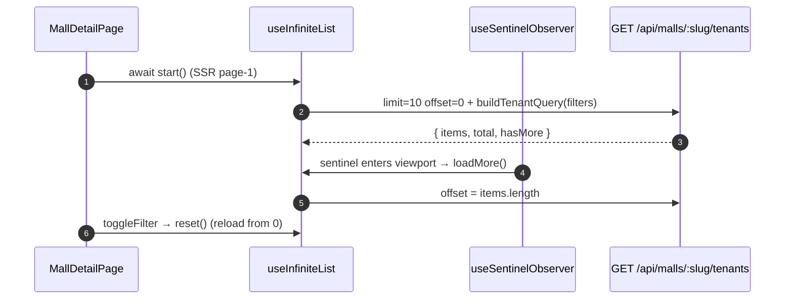

# Mall Directory

## TL;DR

`/mall` (hub of 5 malls) and `/mall/:slug` (tenants) are an SEO directory with no login/quota/LLM. Infinite scroll at 10/page (SSR page 1, continues on the client), server-side filter chips (reset the page), client-side keyword search, a promo strip above the list, and a CTA to `/food?mall=slug`.

## Entry Points

- `app/features/mall/MallListPage.vue` — `GET /api/malls?limit&offset`.
- `app/features/mall/MallDetailPage.vue` — `GET /api/malls/:slug/tenants?limit&offset&halal&budget&mission`.

## Sequence



1. Without `?limit` the API returns the legacy array (40 tenants); `applyInfinitePage` wraps it (`hasMore` false).
2. Column filters run in SQL; `mission` (array) is filtered in memory; paging is sliced after all filters.
3. `getTenantPromo` derives the promo badge from `promo` or `hype_tiktok` — no fabricated data.

## Key Components

| Component             | File                                            | Role                             |
| --------------------- | ----------------------------------------------- | -------------------------------- |
| `useInfiniteList`     | `app/common/composables/useInfiniteList.ts`     | start / loadMore / reset + state |
| `useSentinelObserver` | `app/common/composables/useSentinelObserver.ts` | IntersectionObserver sentinel    |
| `applyInfinitePage`   | `app/utils/pagination.ts`                       | Merge page + dedupe (pure)       |
| `TenantCard`          | `app/features/mall/components/TenantCard.vue`   | Tenant card S2c                  |
| `PromoStrip`          | `app/features/mall/components/PromoStrip.vue`   | V13C promo strip (max 3)         |

## Data

```json
{
  "items": [
    {
      "name": "Kopi Kekinian",
      "category": "coffee",
      "floor": "2",
      "halal": true
    }
  ],
  "total": 40,
  "hasMore": true
}
```

## Failure & State

- Limit is clamped to max 50; negative offset → 0 (`parsePaginationParams`).
- Mall slug not found → 404; fetch fails → error box + "Coba lagi" (disabled while `pending`).

## See Also

[quiz-food](../quiz-food/README.md)
