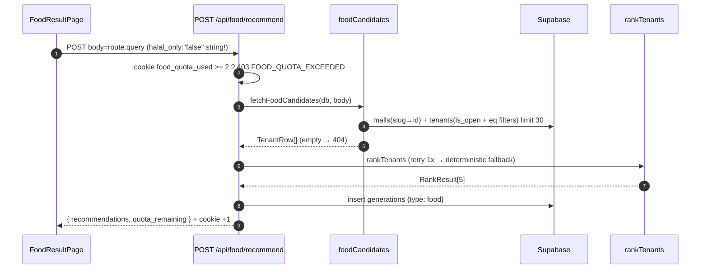

# Quiz & Result — Food

## TL;DR

4 questions (mall → mission → budget → group + halal/kids toggles). Coming from the directory (`/food?mall=slug`) skips Q1. The server filters tenants in Supabase (free, max 30), the LLM only ranks the Top 5, and the result is merged with tenant data + a Maps link. Anon gets at most 2x/day.

## Entry Points

- `app/pages/food.vue` → `FoodQuizPage.vue` (`getFoodStartStep(?mall, FOOD_MALL_SLUGS)`).
- `app/pages/result-food.vue` → `FoodResultPage.vue`.
- `app/server/api/food/recommend.post.ts`.

## Sequence



1. The `.eq()` filters are built by `buildFoodEqFilters`; `coerceBool` prevents the string `"false"` from turning on the halal filter.
2. Tri-state: `halal`/`kids` NULL are automatically excluded when the filter is on; the UI shows ❓.
3. `toTenantRecommendation` adds `maps_url` (`buildMapsUrl`) and `needs_survey`.
4. In the hero: the gift banner (`Ada -20% buat lu` + `Buka →`) opens `VoucherSheet` (3 seed promos `FOOD_PROMOS`); claiming goes through [voucher-claim](../voucher-claim/README.md).

## Key Components

| Component              | File                                             | Role                                           |
| ---------------------- | ------------------------------------------------ | ---------------------------------------------- |
| `FOOD_QUESTIONS`      | `app/features/food/constants/questions.ts`      | Question data + seed promos + valid slugs     |
| `fetchFoodCandidates` | `app/server/utils/foodCandidates.ts`            | Tenant candidates (404 if mall/tenants empty)|
| `buildFoodEqFilters`  | `app/server/utils/tenantFilters.ts`              | Body → eq conditions (pure, tested)          |
| `buildFoodHero/Chips` | `app/features/food/utils/resultHero.ts`         | Hero data, chips, rank #1–3                  |
| `VoucherSheet`         | `app/features/food/components/VoucherSheet.vue` | 3-promo picker + Klaim per row               |

## Data

```json
{
  "recommendations": [
    {
      "name": "Kopi Kekinian",
      "category": "coffee",
      "floor": "2",
      "halal": true,
      "budget_tier": "mid",
      "price_min": 50000,
      "price_max": 100000,
      "kids_friendly": null,
      "hype_tiktok": false,
      "reason": "Cocok buat nongkrong",
      "maps_url": "https://www.google.com/maps/search/Kopi%20Kekinian%20grand-indonesia",
      "data_source": "curated",
      "needs_survey": true
    }
  ],
  "quota_remaining": 1
}
```

## Failure & State

- Quota exhausted → `403 FOOD_QUOTA_EXCEEDED`; mall not found → 404; no candidates → 404 ("Tidak ada tenant cocok").
- LLM returns a wrong format / hallucinated names → retry 1x → `buildRankFallback` (Food never returns 500 because of the LLM).
- The `food_quota_used` cookie (maxAge 1 day) is incremented by 1 only on success.

## See Also

[quota](../quota/README.md) · [llm](../llm/README.md) · [voucher-claim](../voucher-claim/README.md) · [mall-directory](../mall-directory/README.md)
