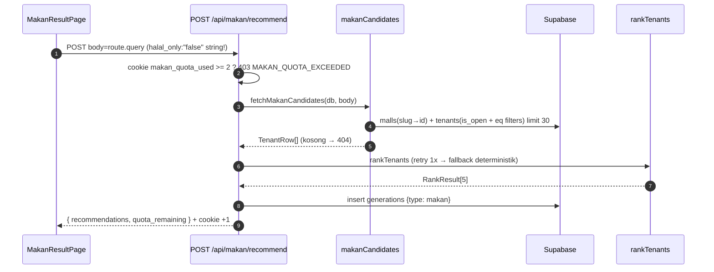

# Quiz & Result — Makan

## TL;DR

4 pertanyaan (mall → misi → budget → rombongan + toggle halal/kids). Dari direktori (`/makan?mall=slug`) Q1 di-skip. Server memfilter tenant di Supabase (gratis, max 30), LLM hanya me-ranking Top 5, hasil digabung data tenant + link Maps. Anon maksimal 2x/hari.

## Entry Points

- `app/pages/makan.vue` → `MakanQuizPage.vue` (`getMakanStartStep(?mall, MAKAN_MALL_SLUGS)`).
- `app/pages/result-makan.vue` → `MakanResultPage.vue`.
- `app/server/api/makan/recommend.post.ts`.

## Sequence



1. Filter `.eq()` dibangun `buildMakanEqFilters`; `coerceBool` mencegah `"false"` (string) menyalakan filter halal.
2. Tri-state: `halal`/`kids` NULL otomatis ter-exclude saat filter nyala; UI menampilkan ❓.
3. `toTenantRecommendation` menambah `maps_url` (`buildMapsUrl`) dan `needs_survey`.
4. Di hero: banner gift (`Ada -20% buat lu` + `Buka →`) membuka `VoucherSheet` (3 promo seed `MAKAN_PROMOS`); klaim lewat [voucher-claim](../voucher-claim/README.md).

## Key Components

| Component                | File                                              | Role                                              |
| ------------------------ | ------------------------------------------------- | ------------------------------------------------- |
| `MAKAN_QUESTIONS`        | `app/features/makan/constants/questions.ts`       | Data pertanyaan + promo seed + slug valid         |
| `fetchMakanCandidates`   | `app/server/utils/makanCandidates.ts`             | Kandidat tenant (404 kalau mall/tenant kosong)    |
| `buildMakanEqFilters`    | `app/server/utils/tenantFilters.ts`               | Body → kondisi eq (pure, tested)                  |
| `buildMakanHero/Chips`   | `app/features/makan/utils/resultHero.ts`          | Data hero, chips, rank #1–3                       |
| `VoucherSheet`           | `app/features/makan/components/VoucherSheet.vue`  | Picker 3 promo + Klaim per row                    |

## Data

```json
{
  "recommendations": [
    {
      "name": "Kopi Kekinian",
      "category": "kopi",
      "lantai": "2",
      "halal": true,
      "budget_tier": "menengah",
      "price_range": "Rp 50-100rb",
      "kids_friendly": null,
      "hype_tiktok": false,
      "reason": "Cocok buat nongkrong",
      "maps_url": "https://www.google.com/maps/search/Kopi%20Kekinian%20grand-indonesia",
      "data_source": "curated",
      "needs_survey": true
    }
  ],
  "quota_remaining": 1
}
```

## Failure & State

- Quota habis → `403 MAKAN_QUOTA_EXCEEDED`; mall tidak ada → 404; tidak ada kandidat → 404 ("Tidak ada tenant cocok").
- LLM salah format/nama halu → retry 1x → `buildRankFallback` (makan tidak pernah 500 karena LLM).
- Cookie `makan_quota_used` (maxAge 1 hari) naik +1 hanya saat sukses.

## See Also

[quota](../quota/README.md) · [llm](../llm/README.md) · [voucher-claim](../voucher-claim/README.md) · [mall-directory](../mall-directory/README.md)
