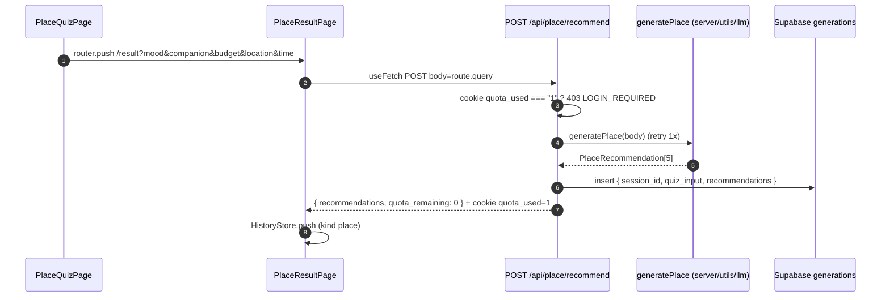

# Quiz & Result — Place

## TL;DR

5 questions (mood → companion → budget → area → time), 1 question per screen, tapping an option = next. At the end, answers are sent via query string to `/result`, which calls `POST /api/place/recommend` and shows 5 places (hero deck + chips + rank). Anon gets only 1x/day.

## Entry Points

- `app/pages/quiz.vue` → `PlaceQuizPage.vue` (local state `step` + `answers`).
- `app/pages/result.vue` → `PlaceResultPage.vue` (`useFetch` POST, body = `route.query`).
- `app/server/api/place/recommend.post.ts` — POST handler.

## Sequence



1. The quiz does not call the API; it only does `router.push({ path: "/result", query })`.
2. The server checks the `quota_used` cookie; `"1"` → 403 (`isWall` in the UI = orange box + login).
3. `generatePlace` calls the LLM with 1 retry; the result is validated by `parsePlaceResults`.
4. The hero card is computed by `buildPlaceHero(rec, idx)`; "Lainnya →" shifts `idx` without re-fetching.

## Key Components

| Component          | File                                         | Role                                          |
| ------------------ | -------------------------------------------- | --------------------------------------------- |
| `PLACE_QUESTIONS` | `app/features/place/constants/questions.ts` | Data for the 5 questions                       |
| `QuizHeader`       | `app/common/components/QuizHeader.vue`       | Ink header + lime segments (also used by Food)|
| `QuizOptionList`   | `app/common/components/QuizOptionList.vue`   | Answer options                                |
| `buildPlaceHero`  | `app/features/place/utils/resultHero.ts`    | Recommendation → hero data (pure, tested)    |
| `ResultError`      | `app/common/components/ResultError.vue`      | Quota wall vs error + Coba lagi              |

## Data

```json
{
  "recommendations": [
    {
      "name": "Rooftop Senayan",
      "category": "rooftop",
      "reason": "sunset + live music",
      "estimated_cost": "Rp 150rb",
      "location_area": "Senayan, Jaksel",
      "best_time": "sore",
      "confidence": "high"
    }
  ],
  "quota_remaining": 0
}
```

## Failure & State

- Anon quota exhausted → `403 LOGIN_REQUIRED`; the UI shows the wall (quota is not deducted on other errors).
- LLM fails 2x → error is thrown (Place has no deterministic fallback yet, unlike Food).
- Quota is tracked by the `quota_used` cookie (maxAge 1 day) + `session_id` (30 days).

## See Also

[quota](../quota/README.md) · [llm](../llm/README.md) · [history](../history/README.md)
