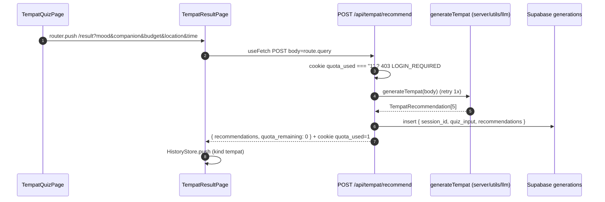

# Quiz & Result — Tempat

## TL;DR

5 pertanyaan (mood → companion → budget → area → waktu), 1 layar 1 tanya, tap opsi = lanjut. Di akhir, jawaban dikirim via query string ke `/result`, yang `POST /api/tempat/recommend` dan menampilkan 5 tempat (hero deck + chips + rank). Anon hanya 1x/hari.

## Entry Points

- `app/pages/quiz.vue` → `TempatQuizPage.vue` (state lokal `step` + `answers`).
- `app/pages/result.vue` → `TempatResultPage.vue` (`useFetch` POST, body = `route.query`).
- `app/server/api/tempat/recommend.post.ts` — handler POST.

## Sequence



1. Quiz tidak memanggil API; hanya `router.push({ path: "/result", query })`.
2. Server memeriksa cookie `quota_used`; `"1"` → 403 (`isWall` di UI = kotak orange + login).
3. `generateTempat` memanggil LLM, 1x retry; hasil divalidasi `parseTempatResults`.
4. Hero kartu dihitung `buildTempatHero(rec, idx)`; "Lainnya →" menggeser `idx` tanpa fetch ulang.

## Key Components

| Component              | File                                                | Role                                              |
| ---------------------- | --------------------------------------------------- | ------------------------------------------------- |
| `TEMPAT_QUESTIONS`     | `app/features/tempat/constants/questions.ts`        | Data 5 pertanyaan                                 |
| `QuizHeader`           | `app/common/components/QuizHeader.vue`              | Header ink + segmen lime (dipakai juga Makan)     |
| `QuizOptionList`       | `app/common/components/QuizOptionList.vue`          | Opsi jawaban                                      |
| `buildTempatHero`      | `app/features/tempat/utils/resultHero.ts`           | Rekomendasi → data hero (pure, tested)            |
| `ResultError`          | `app/common/components/ResultError.vue`             | Wall quota vs error + Coba lagi                   |

## Data

```json
{
  "recommendations": [
    {
      "name": "Rooftop Senayan",
      "category": "rooftop",
      "reason": "sunset + live music",
      "estimated_cost": "Rp 150rb",
      "location_area": "Senayan, Jaksel",
      "best_time": "sore",
      "confidence": "high"
    }
  ],
  "quota_remaining": 0
}
```

## Failure & State

- Quota anon habis → `403 LOGIN_REQUIRED`; UI menampilkan wall (tidak memotong quota saat error lain).
- LLM gagal 2x → error dilempar (tempat belum punya fallback deterministik, beda dengan Makan).
- Quota dilacak cookie `quota_used` (maxAge 1 hari) + `session_id` (30 hari).

## See Also

[quota](../quota/README.md) · [llm](../llm/README.md) · [history](../history/README.md)
