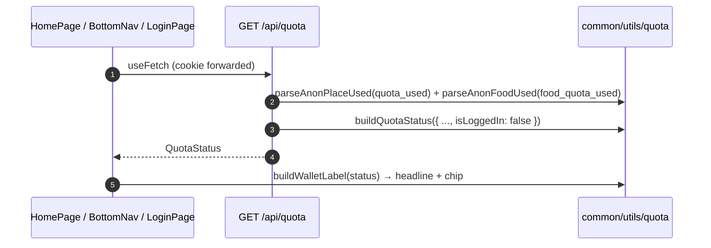

# Quota

## TL;DR

Quota is tracked via cookies (MVP). `GET /api/quota` builds the split place+food status from the cookies and always answers on the anon path (place 1, food 2). Pages (Home wallet, Login banner, BottomNav sheet) use the same response; fetch fails → fresh-anon fallback, not the registered numbers.

## Entry Points

- `app/server/api/quota.get.ts` — `GET /api/quota`.
- Consumers: `HomePage.vue`, `LoginPage.vue`, `BottomNav.vue` (`useFetch`).

## Sequence



## Data

```json
{
  "place": { "used": 0, "limit": 1, "remaining": 1 },
  "food": { "used": 1, "limit": 2, "remaining": 1 },
  "is_logged_in": false,
  "reset_at": null,
  "login_cta": "Login gratis → buka 2 tempat + 5 makan/hari"
}
```

## Failure & State

- Cookie `quota_used` = `"1"` (place) and `food_quota_used` 0–2 (clamped); garbage values = 0.
- The registered limit (2+5) already exists in `buildQuotaStatus`, but the server does not use the session yet → always anon. **Known gap.**
- `authGate.ts` holds the wall predicates (#1–#4); some are not used by the UI yet (tested only).

## See Also

[quiz-place](../quiz-place/README.md) · [quiz-food](../quiz-food/README.md) · [auth](../auth/README.md)
