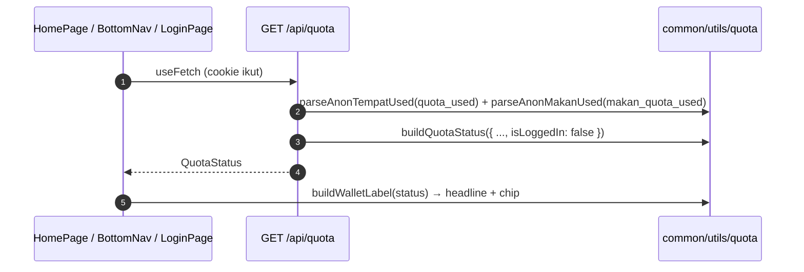

# Quota

## TL;DR

Quota dilacak lewat cookie (MVP). `GET /api/quota` membangun status split tempat+makan dari cookie dan selalu menjawab jalur anon (tempat 1, makan 2). Halaman (Home wallet, Login banner, BottomNav sheet) memakai respons yang sama; gagal fetch → fallback anon fresh, bukan angka register.

## Entry Points

- `app/server/api/quota.get.ts` — `GET /api/quota`.
- Konsumen: `HomePage.vue`, `LoginPage.vue`, `BottomNav.vue` (`useFetch`).

## Sequence



## Data

```json
{
  "tempat": { "used": 0, "limit": 1, "remaining": 1 },
  "makan": { "used": 1, "limit": 2, "remaining": 1 },
  "is_logged_in": false,
  "reset_at": null,
  "login_cta": "Login gratis → buka 2 tempat + 5 makan/hari"
}
```

## Failure & State

- Cookie `quota_used` = `"1"` (tempat) dan `makan_quota_used` 0–2 (dijepit); nilai ngaco = 0.
- Register limit (2+5) sudah ada di `buildQuotaStatus`, tetapi server belum memakai session → selalu anon. **Known gap.**
- `authGate.ts` menyimpan predikat wall (#1–#4); sebagian belum dipakai UI (hanya diuji).

## See Also

[quiz-tempat](../quiz-tempat/README.md) · [quiz-makan](../quiz-makan/README.md) · [auth](../auth/README.md)
