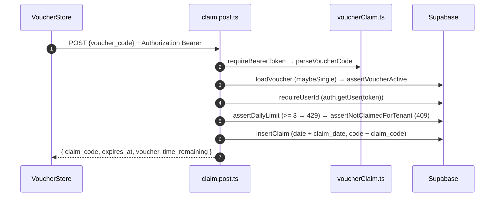

# Voucher Claim

## TL;DR

Klaim voucher WAJIB login (anti-farming). Browser mengirim `POST /api/voucher/claim` dengan Bearer access token Supabase lewat `VoucherStore`. Server menjalankan langkah kecil berurutan di `server/utils/voucherClaim.ts`: token → kode → voucher aktif → verifikasi user → rate-limit 3/hari → 1 tenant/hari → insert dual-write → countdown 23:59 WIB.

## Entry Points

- `VoucherSheet.vue` (picker 3 promo) → `MakanResultPage.claimRow` → `VoucherStore.claimVoucher(code)`.
- `app/server/api/voucher/claim.post.ts`.

## Sequence



## Data

```json
{
  "status": "ok",
  "claim_code": "WKD-7X2K9A",
  "expires_at": "2026-10-16T16:59:00.000Z",
  "voucher": { "name": "Kopi Weekday -20%", "discount_percent": 20 },
  "time_remaining": { "hours": 3, "minutes": 10, "expired": false }
}
```

## Failure & State

| Status | Penyebab                                   |
| ------ | ------------------------------------------ |
| 400    | kode kosong / promo nonaktif / belum aktif / kadaluarsa |
| 401    | tanpa Bearer / token tidak valid           |
| 404    | voucher tidak ditemukan                    |
| 409    | sudah klaim tenant ini hari ini (termasuk race UNIQUE `23505`) |
| 429    | lebih dari 3 klaim/hari                    |

- Dual-write kolom lama (`date`, `code`) + baru (`claim_date`, `claim_code`) menghindari 500 di skema produksi.
- Klien: `claiming` mencegah double-klik; klaim kedua saat berjalan mengembalikan `status: "busy"` tanpa request.

## See Also

[quiz-makan](../quiz-makan/README.md) · [security](../cross-cutting/security/README.md)
