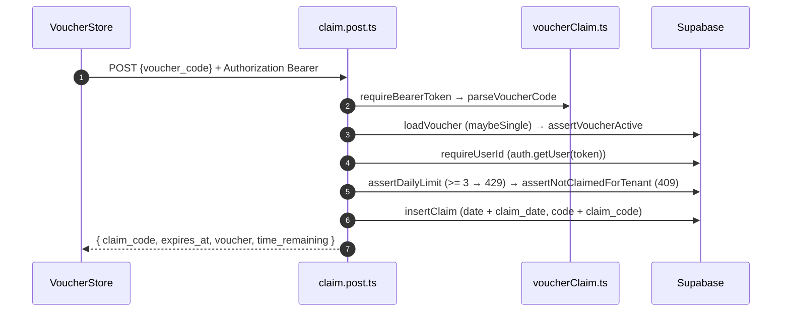

# Voucher Claim

## TL;DR

Claiming a voucher REQUIRES login (anti-farming). The browser sends `POST /api/voucher/claim` with the Supabase Bearer access token via `VoucherStore`. The server runs small sequential steps in `server/utils/voucherClaim.ts`: token → code → active voucher → user verification → rate limit 3/day → 1 tenant/day → dual-write insert → 23:59 WIB countdown.

## Entry Points

- `VoucherSheet.vue` (3-promo picker) → `FoodResultPage.claimRow` → `VoucherStore.claimVoucher(code)`.
- `app/server/api/voucher/claim.post.ts`.

## Sequence



## Data

```json
{
  "status": "ok",
  "claim_code": "WKD-7X2K9A",
  "expires_at": "2026-10-16T16:59:00.000Z",
  "voucher": { "name": "Kopi Weekday -20%", "discount_percent": 20 },
  "time_remaining": { "hours": 3, "minutes": 10, "expired": false }
}
```

## Failure & State

| Status | Cause                                                          |
| ------ | -------------------------------------------------------------- |
| 400    | empty code / promo inactive / not yet active / expired       |
| 401    | no Bearer / invalid token                                     |
| 404    | voucher not found                                             |
| 409    | already claimed this tenant today (including UNIQUE race `23505`)|
| 429    | more than 3 claims/day                                        |

- Dual-writing the old (`date`, `code`) + new (`claim_date`, `claim_code`) columns avoids a 500 on the production schema.
- Client: `claiming` prevents double-clicks; a second claim while one is in flight returns `status: "busy"` without a request.

## See Also

[quiz-food](../quiz-food/README.md) · [security](../cross-cutting/security/README.md)
